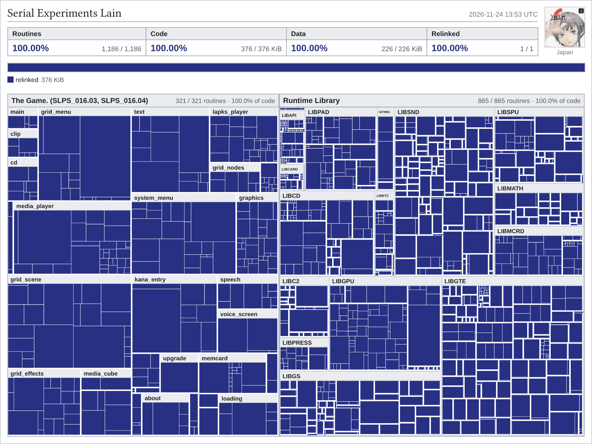
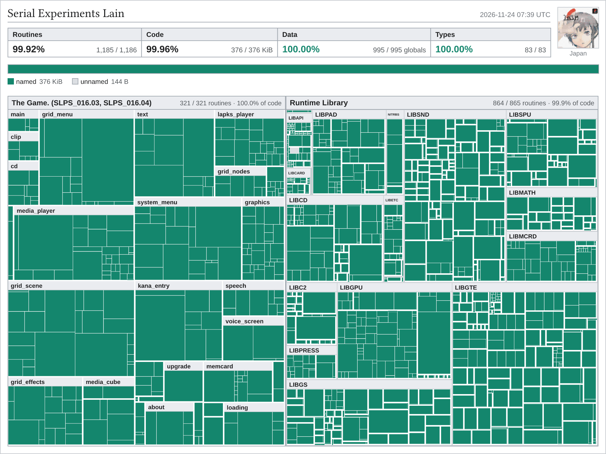

# Lain

A matching decompilation of **Serial Experiments Lain** (Pioneer LDC, 1998, Sony PlayStation) in C and MIPS
assembly. The game ships on two discs that boot the same executable, so one tree builds it, identical byte for
byte to the retail one, with the tools of SN Systems' PsyQ kit for Sony's Runtime Library 4.3: CC1PSX at
`-O2 -G8`, ASPSX, ASMPSX and PSYLINK. Every Runtime Library module the game links, and its startup object, is
decompiled here too.





## Builds

| Disc | Region | Serial | Executable | Size | Executable SHA-256 |
| --- | --- | --- | --- | ---: | --- |
| 1 | NTSC-J | SLPS-01603 | `SLPS_016.03` | 618,496 B | `33e8e8f8ae7eea1a94d392dc851f639090633bcfb037de164ac5c3a39ef02f95` |
| 2 | NTSC-J | SLPS-01604 | `SLPS_016.04` | 618,496 B | `33e8e8f8ae7eea1a94d392dc851f639090633bcfb037de164ac5c3a39ef02f95` |

The discs differ only in the data they carry. Each is one MODE2/2352 data track:

| Disc | Disc image | Size | `.bin` SHA-256 | `.cue` SHA-256 |
| --- | --- | ---: | --- | --- |
| 1 | `Serial Experiments Lain (Japan) (Disc 1).bin` | 583,232,496 B | `8d5945945a23551a92edf10a2f852946ae579906faa4a015213afdb3aeb0ca14` | `b89b26beefade661301e8d588f5339652197f7b97f0a75517bc741e2cc12f584` |
| 2 | `Serial Experiments Lain (Japan) (Disc 2).bin` | 746,172,000 B | `a7393736ec32cc6d834c33ad6f7ca7b6f4b9847e032f1f7a7a2c3fb891bb0aa6` | `f4a2df2f86fbdc27dfe3f330d8ade8b69fc37e3f74b5f638bf6c744528145ad1` |

## State

- **The game's code is all source.** Its 46 units (39 in C, 7 of data in assembly), the startup and the
  NITR-BS decoder, built with the tools above and linked with Sony's libraries, give the retail executable byte
  for byte. Only the game's pictures and models built into the executable (113 arrays, 106,624 bytes) are not
  in the tree: the source includes them from the reader's own executable.
- **Sony's libraries are source too, checked another way.** Sony compiled Runtime Library 4.3, LIBSN apart,
  with a GNU C 2.7.2 and an assembler that no kit ships. All 445 modules the game links from the kit's libraries
  are decompiled in `src/lib`. Each was checked against the kit's archive (six of LIBPAD's against the
  executable) with a GNU C 2.7.2 built from its released source, LIBSN's with the DOS tools of earlier kits.
  No tool of the 4.3 kit can repeat that check, so a build from period tools links the kit's own archives, as
  the game's authors did.
- **One link input is not source:** the order in which the linker placed the uninitialized globals
  (`config/lain/commons.tsv`). It follows the authors' names, which are lost.
- **What matching means here.** The executable matches when the tools turn this source into the bytes the
  retail disc holds. That is a claim about the output, not the text: where the compiler's output does not decide
  a construct, the source's form is a reconstruction, and the names are descriptive names chosen here
  ([docs/names.md](docs/names.md)).
- **Only the executable is rebuilt.** Everything else on the discs (clips, images, movies, sound, voice) is data
  the game reads, described in [docs/formats.md](docs/formats.md).

## The build

No file of the game or of Sony's development kit is in this repository. The build is stated as tables under
`config/lain/`: the tools by name, version and SHA-256, each part's options, the link order, the kit's headers
by SHA-256 and the executable's SHA-256. `build.sh`, a POSIX shell script generated from those tables, checks your
PsyQ 4.3 kit and retail executable by SHA-256, compiles the game's units and the NITR-BS decoder, links them with
the kit's library archives, and checks the result's SHA-256. Six modules of the controller library, which the
game links in a form the 4.3 kit's archive does not hold, are taken from your executable
(`config/lain/stated.tsv`, 12,432 bytes). [docs/building.md](docs/building.md) gives every step and tool.

### Verifying with `build.sh`

With the PsyQ 4.3 kit and your own copy of the executable (`SLPS_016.03`, from either disc):

```
PSYQ_4_3=/path/to/psyq-4.3 SLPS_EXE=/path/to/SLPS_016.03 sh build.sh
```

`PSYQ_4_3` names the kit's root, the directory holding `PSX/INCLUDE`, `PSX/LIB` and the tools. The script
needs only a POSIX shell with its standard utilities and `sha256sum` or `shasum`. Every tool of this build is a Win32 program:
on Windows they run directly (from Git Bash, for one), elsewhere `WIN32_RUNNER` names the command that runs
one. `sh build.sh --help` lists every variable and option. A run that reproduces the retail executable ends
with `Verified 1 executable(s) cleanly.`; any input or result whose SHA-256 differs stops it with an error.

`.github/workflows/verify.yml` runs the same script on a hosted Linux runner at each push to `master` and
publishes the executable's match report once its SHA-256 check passes. It runs the kit's Win32 tools with
`wibo`, a freely available runner checked by SHA-256: one way to run `build.sh` off Windows. The kit and the
retail executable are not in this repository; a fork without them builds nothing.

## Layout

| Path | Holds |
| --- | --- |
| `src/*.c`, `src/*.s` | The game's own code: 39 C units and 7 data units in assembly, in the original link's order (`config/lain/SLPS.LNK`), each named for what it holds. Where the binary shows an original object's boundaries (small-data addressing, section order), a file holds that object. |
| `src/lib/<library>/` | Sony's Runtime Library, decompiled, one file per module, with each library's `<LIB>.LST` in archive order; the startup (`src/lib/obj/2MBYTE.s`); and the NITR-BS decoder (`src/lib/nitrbs/`), a library of the game's own. |
| `include/` | The game's headers, and the library's headers that the game or several libraries include. |
| `config/lain/` | The build as tables (`tools.tsv`, `flags.tsv`, `builds.tsv`, `libraries.tsv`, `assets.tsv`, `stated.tsv`, `headers.sha256`), the linker command file `SLPS.LNK`, the declared commons order `commons.tsv`, and the match report `reports/SLPS_016.03.json`. |
| `build.sh` | Standalone POSIX build and verification script generated from `config/lain/`. |
| `docs/` | The documents below. |
| `assets/` | Cover art; the progress images live on the `pages` branch. |

## Documents

- [docs/building.md](docs/building.md): the tools and what the game's code shows of them, Sony's library
  recipes, the stated modules, the declared commons order, and what `build.sh` does and proves.
- [docs/program-map.md](docs/program-map.md): how the program is organised, from the start screen to the grid,
  its memory layout, and the source by subsystem.
- [docs/formats.md](docs/formats.md): the files on the discs, how the game finds them, and every format it reads,
  with the routine that reads each.
- [docs/names.md](docs/names.md): how the names were chosen, the few the image spells, and the program's words.
- [docs/kept-constructs.md](docs/kept-constructs.md): the constructs the source keeps in an unusual form because
  the original's bytes need it, by file.
- [docs/findings.md](docs/findings.md): what the shipped executable and discs hold that play does not reach—unreachable
  routines and branches, unreferenced table rows and archive parts, rare events and their odds, and build facts,
  each with its source or disc proof.
- [docs/systems/](docs/systems/): fourteen system documents covering the engine and game subsystems in detail.

## Licence

Original game: **Serial Experiments Lain** © 1998 Pioneer LDC. No original game files are in this repository.

The material authored here — reconstructed source text, names, comments, documentation and build
configuration — is licensed under both the Viral Public License ([LICENSE-VPL](LICENSE-VPL)) and the Source
Seppuku License ([LICENSE-SSL](LICENSE-SSL)). That grant covers only what is authored here; the original game
and Sony's PlayStation SDK remain their respective owners'.
